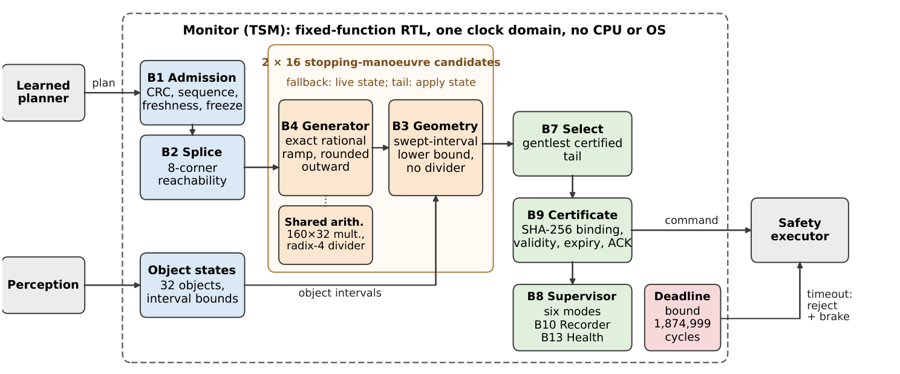

# Hardware Runtime Assurance of a Learned Trajectory Planner

**Fidelity-validated FPGA deployment and finite-bit stopping certification for automated driving**

This repository holds the sources, scripts and evaluation outputs behind a journal manuscript currently under review at *Engineering Applications of Artificial Intelligence*. It is made available so that editors and reviewers can check the reported results.

> **Status and terms of use.** Research artifact for peer review, not a maintained software release. No open-source licence is granted: all rights are reserved by the authors. You may read the code and re-run the checks to verify the paper; please do not redistribute or reuse it in other work without written permission. The hardware design is being developed further, and this repository may be made private after the review.

---

## Contents

- [Overview](#overview)
- [Headline results](#headline-results)
- [Repository layout](#repository-layout)
- [Reproducing the main checks](#reproducing-the-main-checks)
- [What is not included](#what-is-not-included)
- [Tools and hardware](#tools-and-hardware)
- [Notes on reading the files](#notes-on-reading-the-files)

---

## Overview

The work combines two hardware blocks on one FPGA path:

1. **Learned trajectory planner.** A Transformer encoder and gated-recurrent-unit (GRU) decoder with 4-bit weights and 8-bit activations (W4A8). An executable hardware model, bit-exact with the encoder RTL, ties the hardware approximations back to the trained network.
2. **Trajectory safety monitor (TSM).** A fixed-function RTL monitor, with no CPU or operating system. A planner output is applied only after the monitor certifies, in integer arithmetic, a braking-only stop from the measured state that stays separated from every declared object trajectory in continuous time. The monitor also checks packet integrity, freshness and expiry on the same path, and a hardware deadline forces reject-and-brake on timeout.

<p align="center">
  
</p>
<p align="center"><em>Monitor (TSM) data path between the learned planner and the safety executor.</em></p>

## Headline results

All numbers below are taken from the manuscript; the folder that supports each one is given in the right-hand column.

| Result | Evidence in this repository |
|---|---|
| Planner latency of 39.8 ms at 150 MHz (RTL simulation) | `planner/tb/e2e/`, `planner/zcu106_archive_2026-10-07/` |
| On 5,419 nuScenes validation keyframes, the hardware model matches floating-point average error within 1.4 cm | `planner/eval_trainval/out/` (`pred_fp32.npy`, `pred_w4a8.npy`, `pred_hw_new.npy`, `results.json`) |
| One-sided soundness of the monitor's integer reference functions, supported by machine-checked SMT lemmas | `monitor_tsm/proof/` (`run_all.py`, `PROOF.md`) |
| Monitor response bounded at 18.75 ms by a k-induction proof over its abstracted control logic (the target was 10 ms) | `monitor_tsm/proof/watchdog/` |
| The monitor RTL matches its integer reference model in simulation | `monitor_tsm/golden/`, `monitor_tsm/tb/`, `monitor_tsm/verify/` |
| On 150 nuScenes validation scenes, the replay accepts 3 of 200 plans labelled unsafe by a pre-specified oracle, and rejects 50% of safe plans | `monitor_tsm/eval_nuscenes/` |
| In closed-loop nuPlan simulation, the monitor's model halves the collisions of a planner blinded to other agents; a simple responsibility-sensitive (RSS) rule does the same, and the monitor lowers the fault-free score | `monitor_tsm/eval_nuplan/` (`W8_REPORT.md`, `RSS_REPORT.md`, `results/`) |
| Monitor needs 2.4 times the planner's logic; planner and monitor run jointly only on the larger VCU118 device | `monitor_tsm/synth/`, `monitor_tsm/vcu118/` |

The limitations are stated in the manuscript. The monitor misses its 10 ms response target, it rejects many safe plans, and in closed loop it shows no safety advantage over the simple RSS rule.

## Repository layout

```
.
├── planner/                       Learned trajectory planner
│   ├── rtl/                       Planner RTL: Transformer encoder, GRU decoder, DMA, front end
│   ├── tb/                        Unit and end-to-end testbenches
│   ├── model/                     FP32 and W4A8 reference models (PyTorch)
│   ├── data_loaders/              nuScenes token construction
│   ├── hwspec/                    Executable hardware model, bit-exact with the encoder RTL
│   ├── eval_trainval/             Evaluation on 5,419 nuScenes validation keyframes
│   ├── gpu/                       Laptop-GPU latency benchmark of the FP32 model
│   ├── training/                  Training log summary
│   ├── results/                   Earlier evaluation outputs
│   └── zcu106_archive_2026-10-07/ Frozen ZCU106 board build: sources, block design, firmware,
│                                  timing/utilisation/power reports, board logs, clock sweep
├── monitor_tsm/                   Trajectory safety monitor (TSM)
│   ├── spec/                      Specification
│   ├── golden/                    Integer reference model (Python)
│   ├── rtl/                       Monitor RTL
│   ├── proof/                     Z3 lemma suite and k-induction deadline proof
│   ├── wcet/                      Cycle-bound analysis and calibration
│   ├── tb/  verify/  vectors/     RTL testbenches, regression and replay checks
│   ├── fault/                     Register fault-injection campaign
│   ├── eval_nuscenes/             Open-loop nuScenes study (pre-registered protocols, scripts, results)
│   ├── eval_nuplan/               Closed-loop nuPlan study (planner wrapper incl. RSS baseline, analysis)
│   ├── e2e_traj_tsm/              Joint planner + monitor RTL bench
│   ├── synth/  board/  vcu118/    Synthesis reports, ZCU106 clock-sweep builds, VCU118 joint build
│   └── sw_baseline/               Software decision core on Cortex-A53 / Cortex-R5F
├── additional_experiments/        Additional analyses: splice sensitivity, integer vs. exact check,
│                                  nuScenes baselines
└── docs/                          Figures used in this README
```

### Mapping to the manuscript

| Manuscript section | Folders |
|---|---|
| Planner architecture (Sec. 4) | `planner/rtl/`, `planner/model/`, `planner/hwspec/` |
| Monitor design and soundness argument (Sec. 5, Theorem 1) | `monitor_tsm/spec/`, `monitor_tsm/golden/`, `monitor_tsm/rtl/`, `monitor_tsm/proof/` |
| Evaluation method and protocols (Sec. 6) | `monitor_tsm/eval_nuscenes/PROTOCOL*.md`, `AMENDMENT_A7.md` |
| RQ1: deployment fidelity (Sec. 7.1, Table 3, Fig. 4) | `planner/eval_trainval/`, `planner/hwspec/`, `additional_experiments/` |
| RQ2: monitor behaviour, nuScenes and nuPlan (Sec. 7.2, Tables 4–5) | `monitor_tsm/eval_nuscenes/`, `monitor_tsm/eval_nuplan/`, `monitor_tsm/verify/`, `monitor_tsm/fault/` |
| RQ3: timing (Sec. 7.3, Fig. 5) | `planner/tb/e2e/`, `monitor_tsm/wcet/`, `monitor_tsm/proof/watchdog/`, `monitor_tsm/board/`, `monitor_tsm/sw_baseline/` |
| RQ4: resources and power (Sec. 7.4, Fig. 6) | `monitor_tsm/synth/`, `monitor_tsm/vcu118/`, `planner/zcu106_archive_2026-10-07/02_synthesis/` |

## Reproducing the main checks

The commands below run from the repository root. Most scripts need the public datasets ([nuScenes](https://www.nuscenes.org/) v1.0-trainval, [nuPlan](https://www.nuscenes.org/nuplan) mini split) in addition to the files here.

**1. SMT lemma suite of the monitor.** No dataset needed; requires `z3-solver`.
```bash
cd monitor_tsm/proof
python run_all.py          # prints 'SUITE PASS' and exits 0 only if every lemma and negative control matches
```

**2. k-induction proof of the response deadline.** Requires SymbiYosys.
```bash
cd monitor_tsm/proof/watchdog
sby -f wd.sby              # deadline bound
sby -f wd_ctl.sby          # control-logic properties
sby -f wd_cover.sby        # reachability covers
```

**3. Integer reference model of the monitor.** See `monitor_tsm/golden/README.md` for a minimal example of `tsmx_cycle` / `certify`.

**4. Planner deployment fidelity (RQ1).** The saved predictions in `planner/eval_trainval/out/` let the FP32, W4A8 and hardware-model comparisons be recomputed without the dataset (NumPy only):
```bash
cd planner/eval_trainval
python -c "
import numpy as np
gt = np.load('out/dataset.npz')['gt']                    # 5,419 keyframes x 4 waypoints x (x, y)
for k in ['fp32', 'w4a8', 'hw_new']:                     # hw_new = final hardware model
    e = np.linalg.norm(np.load(f'out/pred_{k}.npy') - gt, axis=-1)
    print(f'{k:7s} ADE {e.mean():.4f} m   FDE {e[:, -1].mean():.4f} m')
"
```
Expected output: ADE 0.8204 / 0.8165 / 0.8152 m. The hardware model's ADE differs from the FP32 model's by −5.2 mm, as reported in Sec. 7.1. To rebuild the inputs from nuScenes, use `build_dataset.py` and `run_models.py`, after installing the Python packages with `pip install -r planner/requirements.txt`.

**5. Closed-loop nuPlan summaries (RQ2).** `monitor_tsm/eval_nuplan/analyze_w8.py` and `analyze_rss.py` recompute the paired collision counts and McNemar tests from the simulation logs. The resulting summaries are in `results/w8_summary.json` and `results/rss_summary.json`.

**6. RTL simulation.** The testbenches in `planner/tb/` and `monitor_tsm/tb/` run under Verilator or Vivado xsim 2023.2. The run scripts sit next to each testbench.

## What is not included

- **Datasets.** nuScenes and nuPlan are public and must be obtained from their providers under their own licences.
- **Regenerable bulk data.** This covers scene pickles, RTL replay shards (`.mem`), per-sample `.hex` vectors, Verilator build folders, Vivado project folders and bitstreams above 40 MB. The scripts in the same folders regenerate them, and `_skipped_large_files.json` lists every omitted file.
- **FP32 planner checkpoint.** It is not in this repository. The saved FP32 predictions (`planner/eval_trainval/out/pred_fp32.npy`) allow every RQ1 comparison to be checked, and the W4A8 parameters used by the hardware model are in `planner/hwspec/_cache_params.pkl`.
- **Remote-lab details.** Network addresses, host names and device serials of the remote VCU118 lab are replaced by placeholders such as `<LAB_BOARD_IP>`.

## Tools and hardware

| Item | Version / part |
|---|---|
| FPGA tools | AMD Vivado 2023.2 |
| RTL simulation | Verilator; Vivado xsim |
| Formal | Z3 (SMT lemmas); SymbiYosys (k-induction) |
| Python | 3.9 or newer; NumPy, SciPy, PyTorch ≥ 2.0, nuscenes-devkit, nuplan-devkit |
| Boards | ZCU106 (XCZU7EV), VCU118 (XCVU9P) |

## Notes on reading the files

- Several internal notes, logs and code comments are in Vietnamese, the working language of the project. The specifications, proofs and reports cited in the manuscript are in English unless noted.
- Files ending in `_before_*`, `_frozen` or `_unexecuted` are snapshots kept on purpose. They record the state of a script or protocol before a documented amendment, so the pre-registration history in `monitor_tsm/verify/` and `monitor_tsm/eval_nuscenes/` can be audited.
- `planner/zcu106_archive_2026-10-07/` is a read-only snapshot of the first full board run. Its integrity can be checked with `md5sum -c MD5SUMS.txt` inside that folder.

## Citation

The manuscript is under review. Citation details will be added after publication.
